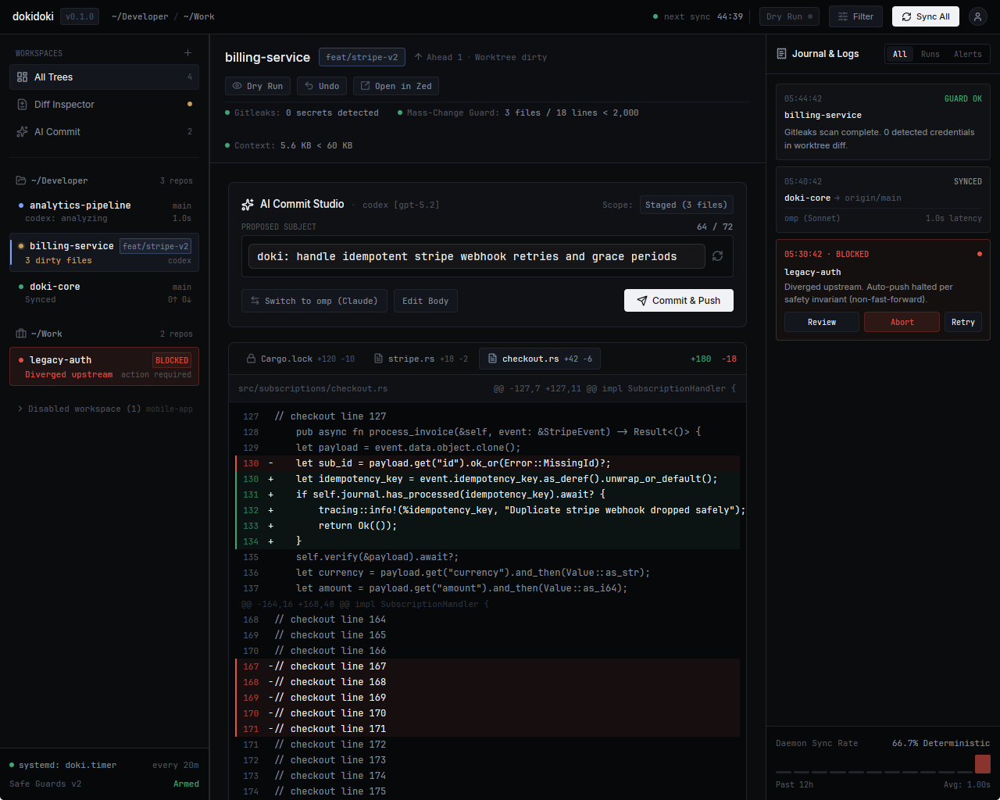

# dokidoki

**dokidoki — auto-commit and auto-sync your git repos with AI commit messages. A safe, local-first desktop app (Rust + GPUI) for Linux and macOS.**

[](https://github.com/henrychea/dokidoki/actions/workflows/ci.yml)
[](LICENSE)
[](https://www.rust-lang.org)



_Sumi dark. Washi light ships as the second theme._

## Why

A working machine accumulates repositories: side projects, forks, dotfiles,
notes. They go dirty, stay dirty for days, and the commit message you would
have written is long gone. Remembering to `git add`, write an honest message,
and push across a dozen repositories is a chore nobody does reliably.

`dokidoki` makes that loop automatic without making it dangerous. It watches
the folders you choose, discovers the repositories inside them, writes a commit
message with a local AI CLI, commits real changes, and pushes to each
repository's own remote on a schedule. Every destructive shortcut is refused,
every run is recorded, and a single toggle turns the whole thing into a dry
run.

## Features

- **AI commit message generator** using the Claude Code (`claude`), Codex
  (`codex`), OpenCode, `omp`, or `pi` CLI you already have. One model per CLI,
  per-repository overrides, a fallback chain, and a deterministic message when
  no agent can answer.
- **Automatic git backup and scheduled git push** for many repositories at
  once. Cron per root, jitter, exponential backoff, and quarantine after
  repeated failures.
- **Repository discovery** under one or more roots at a configurable depth.
  A discovered repository stays disabled until you enable it.
- **Dry run everywhere** — `doki --dry-run`, `doki sync --dry-run`, or the
  in-app toggle. The planned git argv is shown; nothing mutates.
- **Undo** that restores the pre-sync snapshot, only when HEAD still matches
  the run and the run did not push.
- **Secret scanning with gitleaks** (or the built-in scanner) before any diff
  reaches a model, plus a mass-change guard for large deletions.
- **Never force-push.** Diverged branches wait for a human, `main` and `master`
  are commit-only until a repository opts in, and in-progress merges, rebases,
  and cherry-picks are refused rather than repaired.
- **A desktop app and a CLI** built on Rust and GPUI: repository tree, diff
  inspector, AI Commit Studio with an editable subject and 72-character
  counter, journal, settings, a tray on Linux, and two themes with bundled
  fonts.
- **Local-first.** No account, no telemetry, no token storage. Credentials come
  from your existing git configuration and credential helper; state is a SQLite
  file under `XDG_STATE_HOME` (`~/.local/state/doki` on macOS).

## How it compares

`dokidoki` is aimed at unattended, multi-repository commit-and-push with
guardrails. These tools overlap, but they solve different parts of the problem.

| Tool | What it does | How doki differs |
|---|---|---|
| `git-auto-commit` and editor save hooks | Commit from inside an editor when a file is saved | doki runs outside the editor, discovers repositories under your roots, and works on a schedule with guards, push handling, and a journal |
| cron plus `git commit -am` | Commits tracked changes with a fixed message on a timer | doki writes a message from the diff, scans for secrets, enforces a mass-change budget, supports dry run and undo, and handles fetch, divergence, and push |
| GitHub Desktop | Interactive desktop client for staging, committing, and pushing a repository | doki is unattended and multi-repository; GitHub Desktop is a manual, one-repository-at-a-time workflow |
| gitwatch | Watches a path and commits changes as they happen | doki schedules across several roots, generates messages, scans before model calls, and manages the remote side of the sync |
| git-sync | Small script that periodically commits and syncs a single repository | doki is a desktop app plus CLI with a multi-repository journal, agent adapters, and safety invariants enforced in code |
| lazygit | Interactive terminal UI for everyday git operations | lazygit is manual by design; doki automates the commit and push loop and keeps a review UI for the times you want to look |

## Install

Linux x86_64 and aarch64, and macOS Apple Silicon and Intel. Prebuilt
AppImages, tarballs, and macOS disk images are on the
[releases page](https://github.com/henrychea/dokidoki/releases/latest); building
from source is documented below.

### Download

```sh
# AppImage: no install step beyond making it executable
chmod +x dokidoki-<version>-x86_64.AppImage
./dokidoki-<version>-x86_64.AppImage

# tarball: extract and put doki on PATH
tar -xzf doki-<version>-x86_64-unknown-linux-gnu.tar.gz
install -m755 doki-<version>-x86_64-unknown-linux-gnu/doki ~/.local/bin/doki

# macOS: open the disk image, then drag Doki onto Applications
open doki-<version>-aarch64-apple-darwin.dmg

# or unzip the app bundle directly
ditto -x -k doki-<version>-aarch64-apple-darwin.zip /Applications
```

The macOS builds are ad-hoc signed, not notarized, so Gatekeeper refuses the
first launch. Right-click `Doki` > `Open`, then `Open` in the dialog, or clear
the quarantine flag once:

```sh
xattr -dr com.apple.quarantine /Applications/Doki.app
```

Use `aarch64` instead of `x86_64` on ARM. Every release publishes `SHA256SUMS`
next to the artifacts; run this in the download directory to verify:

```sh
sha256sum -c SHA256SUMS
```

On macOS `shasum -a 256 -c SHA256SUMS` does the same job.

The tarball also contains `dokidoki.desktop` and `dokidoki.png` if you want a
menu entry:

```sh
install -Dm644 dokidoki.desktop ~/.local/share/applications/dokidoki.desktop
install -Dm644 dokidoki.png ~/.local/share/icons/hicolor/256x256/apps/dokidoki.png
```

`doki --version` and `doki doctor` confirm the install.

### Runtime dependencies (Linux)

The downloads link against the host graphics stack instead of bundling it, so a
Vulkan driver plus the usual Wayland/X11 client libraries must be present.

Debian/Ubuntu:

```sh
sudo apt-get install -y \
  libvulkan1 mesa-vulkan-drivers \
  libwayland-client0 libxkbcommon0 libxkbcommon-x11-0 \
  libfontconfig1 fontconfig libxcb1 libxcb-xkb1
```

Fedora:

```sh
sudo dnf install -y \
  vulkan-loader mesa-vulkan-drivers \
  libxkbcommon libxkbcommon-x11 wayland \
  fontconfig libxcb
```

Arch:

```sh
sudo pacman -S --needed \
  vulkan-icd-loader vulkan-radeon \
  libxkbcommon libxkbcommon-x11 wayland \
  fontconfig libxcb
```

`libvulkan1`/`vulkan-loader` is the loader; the Vulkan ICD comes from the GPU
driver, so replace `mesa-vulkan-drivers` or `vulkan-radeon` with the package
for your GPU (NVIDIA, Intel, or another Mesa ICD).

There is nothing to install on macOS: `Doki.app` links only against system
frameworks.

### Build from source

On Linux, install the GPUI build dependencies first (Debian/Ubuntu names):

```sh
sudo apt-get install -y \
  build-essential pkg-config \
  libwayland-dev libxkbcommon-dev libxkbcommon-x11-dev \
  libfontconfig-dev libvulkan-dev \
  libx11-xcb-dev libxcb1-dev libxcb-render0-dev libxcb-shape0-dev \
  libxcb-xfixes0-dev libxcb-xkb-dev
```

On macOS, install the Xcode command line tools and Rust:

```sh
xcode-select --install
curl --proto '=https' --tlsv1.2 -sSf https://sh.rustup.rs | sh
```

Then build from a checkout — `cargo install` on Linux, or the app bundle on
macOS, where `packaging/build-macos-app.sh` writes `Doki.app`, the `.dmg`, and
the `.zip` and needs [uv](https://docs.astral.sh/uv/) on `PATH` for `dmgbuild`:

```sh
git clone https://github.com/henrychea/dokidoki.git
cd dokidoki

# Linux
cargo install --path crates/doki

# macOS (x86_64 on Intel)
cargo build --release -p doki
bash packaging/build-macos-app.sh \
  --binary target/release/doki --version <version> --arch aarch64
```

`doki --version` and `doki doctor` confirm the install: `cargo install` puts the
CLI on `PATH`, and `dist/Doki.app` is ready to drag to `/Applications`. `doki`
is not published on crates.io yet; `cargo install --path crates/doki` is the
supported route.

Optional but useful: [gitleaks](https://github.com/gitleaks/gitleaks) on
`PATH`. Without it, doki falls back to its built-in scanner.

## Quick start

1. **Point doki at your repositories.** Create
   `${XDG_CONFIG_HOME:-~/.config}/doki/config.toml` with at least one root:

   ```toml
   [[roots]]
   name = "dev"
   path = "~/Developer"
   max_depth = 2
   schedule = "*/20 * * * *"
   ```

2. **Open the window and enable the repositories you want managed:**

   ```sh
   doki
   ```

   Discovery is not management: every detected repository starts disabled.
   Enable it in **All Trees**, then run `doki doctor` to check git, agents, and
   on Linux inotify, notifications, and the timer.

3. **Preview, then sync:**

   ```sh
   doki sync --all --dry-run   # prints the exact argv, mutates nothing
   doki sync --all             # commit and push every enabled repository
   ```

   Run `doki install-timer` to keep syncing while the window is closed.

## Configuration

Config lives at `${XDG_CONFIG_HOME:-~/.config}/doki/config.toml` and is parsed
with `deny_unknown_fields`: a typo is an error, not a silently ignored setting.
A repository may add `.doki.toml`, which can tighten policy only.

```toml
[discovery]
rescan_minutes = 15
skip_names = [".git", "node_modules", "target", "vendor", ".venv"]
follow_symlinks = false

[[roots]]
name = "dev"
path = "~/Developer"
max_depth = 2
enabled = true
schedule = "*/20 * * * *"
exclude = ["archive/**"]

[sync]
concurrency = 2
commit_scope = "tracked"     # tracked | all | staged
push_mode = "push"           # push | commit-only | bundle
protected = ["main", "master"]
fetch_timeout_seconds = 120
push_timeout_seconds = 300
backoff_max_minutes = 360
quarantine_after = 5

[guards]
secret_scan = true
secret_scanner = "gitleaks"  # gitleaks | trufflehog | off
max_deleted_lines = 2000
max_changed_files = 200
max_diff_bytes_for_model = 60000

[agent]
order = ["omp", "codex"]
timeout_seconds = 90
fallback_on_error = true
max_attempts = 2

[agents.omp]
cli = "omp"
model = "anthropic/claude-sonnet-4.5"
extra_args = ["--no-session"]

[agents.codex]
cli = "codex"
model = "gpt-5.2-codex"
extra_args = ["--ephemeral"]

[[overrides]]
path = "~/Developer/billing"
agent = "codex"
model = "gpt-5.2"

[ui]
theme = "sumi"               # sumi | washi | system
editor = "zed"
window = [1280, 900]

[notify]
desktop = true
coalesce_seconds = 30
```

`model` may be empty, in which case the CLI's own default is used and no model
flag is passed. The full set of keys and the resolution order are documented in
[docs/DESIGN.md](docs/DESIGN.md).

## CLI reference

| Command | What it does |
|---|---|
| `doki` | Open the window; the scheduler runs inside it |
| `doki run --background [--no-tray]` | Scheduler and worker pool without a window, with an optional tray on Linux |
| `doki sync --repo <path> [--dry-run]` | Commit and push one repository |
| `doki sync --all [--dry-run]` | Every enabled repository |
| `doki sync --due [--dry-run]` | Only repositories whose persisted `next_run_at` is due |
| `doki status [--json]` | Discover repositories and print their state |
| `doki agents list` | Show each CLI, whether it is on `PATH`, and its model |
| `doki agents test [<id>]` | Run one fixed prompt through a CLI |
| `doki doctor` | Probe git, gitleaks, agents, config, state dir, and the platform integrations (inotify, D-Bus, timer on Linux) |
| `doki install-timer [--force-write]` | Write systemd user units and print the enable command (Linux only) |
| `doki uninstall-timer` | Print the disable command and remove doki-managed units |
| `doki undo <repo>` | Move HEAD back to the last run's pre-sync snapshot |
| `doki reset-quarantine <repo>` | Clear quarantine so the scheduler retries |

`doki doctor` exits non-zero when any probe is `FAIL`. On macOS the inotify,
desktop notification, and systemd timer probes warn instead, because those
integrations are Linux only. `install-timer` never runs `systemctl`; it prints
the command for you to run. Only units carrying the `# doki-managed` marker are
removed by `uninstall-timer`.

## Safety guarantees

- No git `--force`, `--no-verify`, `reset --hard`, `clean -fd`, or amend of
  published commits.
- `main` and `master` are commit-only unless the repository explicitly opts
  into pushing them.
- Every sync writes `refs/doki/pre-sync/<ts>` and a journal row before its
  first mutation.
- A repository with `MERGE_HEAD`, `rebase-merge/`, `rebase-apply/`,
  `CHERRY_PICK_HEAD`, or `index.lock` is refused, not repaired.
- One sync per repository at a time (`flock` on `$GIT_DIR/doki.lock`), plus a
  global scheduler lock.
- Mass-change and secret guards run before any diff reaches a model. A secret
  finding blocks the run.
- A repository's `.doki.toml` can narrow policy but cannot add a command,
  enable push, or loosen a guard.
- Every state change is journaled, so the UI can always show what ran, when,
  why, and what changed.

## FAQ

### How do I auto-commit git changes?

Add the folder that holds your repositories to `config.toml`, open `doki`, and
enable the repositories you want managed. Each root has a cron schedule; on
each tick doki checks the working tree, and a repository with tracked changes
gets a commit with a message written from the diff.

### How do I automatically push to GitHub on a schedule?

Keep `push_mode = "push"` (the default). After committing, doki fetches the
repository's upstream, fast-forwards when the branch is only behind, and pushes
when it is ahead. `main` and `master` stay commit-only until that repository
opts in. `doki install-timer` keeps the schedule running with the window
closed.

### Can doki generate git commit messages with AI?

Yes. doki builds a prompt from the branch, recent subjects, the diff stat, and
a capped patch, then calls a local agent CLI. It supports Claude Code
(`claude`), Codex, OpenCode, `omp`, and `pi`, with a model per CLI. The model
never runs git and never sees the repository working tree; doki creates the
commit itself.

### Does it work without AI?

Yes. Set `[agent] order = []`, or leave no agent installed. doki falls back to
a deterministic message such as `doki: update 3 files (src, docs)`, and the run
is marked as a fallback. Guarding, committing, pushing, journaling, and undo
all work the same.

### Is it safe? Will it force-push or commit a secret?

doki never force-pushes. Diverged branches stop and wait for a human, protected
branches are not pushed without an opt-in, and repositories in the middle of a
merge, rebase, or cherry-pick are refused. Before a diff reaches a model,
gitleaks (or the built-in scanner) and a mass-change guard run; a finding
blocks the run. Dry run and pre-sync snapshots let you preview and undo.

### Which AI CLIs are supported?

Claude Code (`claude`), Codex (`codex`), OpenCode (`opencode`), `omp`, and
`pi`. Each has an adapter with its own non-interactive invocation and model
flag. `doki agents test` proves an adapter works before you rely on it.

### Does it sync while the window is closed?

Yes on both platforms, with different plumbing. `doki run --background`
schedules syncs without a window and shows a tray icon on Linux. On Linux you
can also run `doki install-timer` to generate a systemd user timer that calls
`doki sync --due`. macOS has no tray and no timer integration yet, so start
`doki run --background` yourself if you want the scheduler without the window.
doki never edits your crontab.

## Roadmap

The shipped phases and the next items are in [docs/ROADMAP.md](docs/ROADMAP.md).
The short version: bundle snapshots with optional upload, per-root model
defaults, multi-machine lease refs, a read-only AI conflict summary, and commit
signing passthrough. Automatic conflict resolution, force push, and token
storage are non-goals.

## Contributing

Issues and pull requests are welcome. Read [CONTRIBUTING.md](CONTRIBUTING.md)
for the Linux build dependencies, the `fmt`/`clippy`/`test` gates, the
`doki: <why>` commit style, and the safety invariants a change must not weaken.
The macOS app builds from the same checkout with the steps above.
Security reports go through [SECURITY.md](SECURITY.md), and participation is
covered by the [Code of Conduct](CODE_OF_CONDUCT.md). Notable changes are
recorded in [CHANGELOG.md](CHANGELOG.md).

## License

MIT. See [LICENSE](LICENSE).

### Third-party

| Component | License | Where |
|---|---|---|
| Inter | SIL Open Font License 1.1 | `assets/fonts/inter/OFL.txt` |
| JetBrains Mono | SIL Open Font License 1.1 | `assets/fonts/jetbrains-mono/OFL.txt` |
| [gpui-kit](https://crates.io/crates/gpui-kit) | Apache-2.0 | Rust dependency |

The bundled font license texts are kept next to the font files.

---

**Maintainer note:** the security and conduct contact addresses are
placeholders; replace them before the public release.
