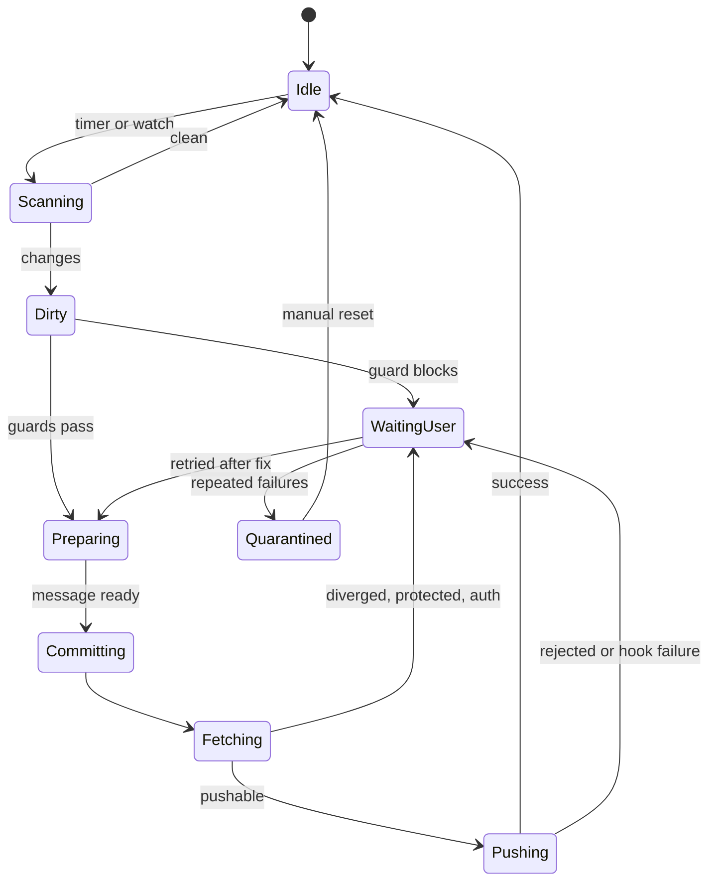

# dokidoki — design notes

Status: implemented through 0.2.0 on Linux and macOS. This document records the decisions behind the shipped app.
Binary name: `doki`. Commit-message prefix: `doki: `.

## 1. Goal

A GPUI desktop app that:

1. Watches one or more folders for git repos. Discovery depth is configurable, default 2.
2. Detects changed working trees and unsynced commits on a cron schedule.
3. Creates meaningful local commits using an AI CLI (`pi`, `omp`, `opencode`, `claude`, `codex`).
4. Pushes to the repo's cloud remote, or records why it cannot.
5. Notifies the user on conflict or error and waits for a manual decision.
6. Never destroys work and never resolves conflicts automatically.

Each AI CLI has its own configurable model. A repo can override the CLI and model.

## 2. Requirements baseline

| Item | Requirement |
|---|---|
| Repository | Rust workspace for the `dokidoki` project; no prior code required |
| Toolchain | Rust stable with edition 2024 support (developed against rustc/cargo 1.99.1) |
| GUI deps (Linux) | Wayland, libxkbcommon, fontconfig, and a Vulkan ICD |
| GUI deps (macOS) | Xcode command line tools; the app links only against system frameworks |
| `gpui` | 0.2.2 on crates.io, upstream Zed |
| `gpui-kit` | 0.10.0, wraps a GPUI fork (`gpui-base`), 75+ widgets, tables, virtual lists, dock, modals |
| Agent CLIs | any of `omp`, `codex`, `opencode`, `claude`, `pi`; install the ones you want to use |
| Design | `design/` holds Sumi dark (default) and Washi light references with the same 1280×1024 layout |

`gpui-kit` and `gpui` 0.2.2 use different GPUI crate identities. They cannot be mixed.
**Decision:** use `gpui-kit` pinned with `=0.10.0`. One dependency, fast delivery for tables, forms, virtual lists, notifications. Revisit only if fork churn becomes unmanageable.
`gpui-kit` does not ship a tree widget; build the repo tree from a virtual list with indent levels.

## 3. Safety invariants

These are non-negotiable. Encode them in `doki-core`, not in the UI.

1. Discovery does not imply management. A detected repo stays disabled until the user enables it.
2. Never run `--force`, `--no-verify`, `reset --hard`, `clean -fd`, or amend published commits.
3. Never push `main`/`master` unless that repo explicitly opts in.
4. Record `refs/doki/pre-sync/<ts>` plus a journal row before the first mutation of a sync run.
5. Refuse to touch a repo with `MERGE_HEAD`, `rebase-merge/`, `CHERRY_PICK_HEAD`, or `index.lock`. Notify and skip.
6. One sync per repo at a time: `flock` on `$GIT_DIR/doki.lock`; second attempt exits as `busy`.
7. Mass-change guard and secret scan run **before** any diff leaves the machine. A diff that trips the secret scan is never sent to a model.
8. Every state change is journaled. The UI can always answer: what ran, when, why, and what changed.

## 4. Architecture

One workspace, one user-facing binary.

```
Cargo.toml                 [workspace]
crates/doki-core/          config, discovery, git, scheduler, guards, state, journal
crates/doki-agent/         adapter per CLI, prompt build, output parse, model resolution
crates/doki-ui/            gpui-kit views
crates/doki/               binary "doki": UI + clap subcommands
design/                    HTML/PNG references (not shipped)
assets/fonts/              bundled Inter + JetBrains Mono (OFL)
```

- No async runtime. Git and agents are subprocess work. Use a fixed worker pool (2 threads default), `std::process::Command`, channels to the UI.
- UI thread never blocks. Worker events arrive through `async-channel`; views update through `cx.spawn`.
- `flock` per repo, plus a global scheduler lock so the in-app scheduler and `doki sync --due` cannot overlap.
- Shell out to `git`. `gix`/`git2` do not cover hooks, LFS, filters, rebase, and credential helpers well enough.

### Processes

```
doki                 UI (default); scheduler runs inside while open
doki run --background scheduler only, optional tray icon (Linux)
doki sync [...]      one-shot sync: --all, --due, --repo <path>, --dry-run
doki status          table or --json
doki agents list|test
doki doctor          environment, auth, agent availability, platform limits (inotify on Linux)
doki install-timer   writes systemd user units (Linux)
doki undo <repo>
```

## 5. Configuration

Path: `${XDG_CONFIG_HOME:-~/.config}/doki/config.toml`. Validated with serde + toml; unknown keys are errors.

```toml
[discovery]
rescan_minutes = 15
skip_names = [".git", "node_modules", "target", "vendor", ".venv"]
follow_symlinks = false

[[roots]]
name = "dev"
path = "~/Developer"
max_depth = 2          # repo at root/a/repo is depth 2; stop descending at a repo
enabled = true
schedule = "*/20 * * * *"
exclude = ["archive/**"]

[[roots]]
name = "work"
path = "~/Work"
max_depth = 2
schedule = "0 */2 * * *"

[sync]
concurrency = 2
commit_scope = "tracked"     # tracked | all | staged
push_mode = "push"           # push | commit-only | bundle
protected = ["main", "master"]
fetch_timeout_seconds = 120
push_timeout_seconds = 300
backoff_max_minutes = 360
quarantine_after = 5

[guards]
secret_scan = true
secret_scanner = "gitleaks"  # gitleaks | trufflehog | off
max_deleted_lines = 2000
max_changed_files = 200
max_diff_bytes_for_model = 60000

[agent]
order = ["omp", "codex"]
timeout_seconds = 90
fallback_on_error = true
max_attempts = 2

[agents.omp]
cli = "omp"
model = "anthropic/claude-sonnet-4.5"
extra_args = ["--no-session"]

[agents.codex]
cli = "codex"
model = "gpt-5.2-codex"
extra_args = ["--ephemeral"]

[agents.claude]
cli = "claude"
model = "claude-sonnet-4-5"
extra_args = []

[agents.opencode]
cli = "opencode"
model = "openai/gpt-5.2"
extra_args = []

[agents.pi]
cli = "pi"
model = "anthropic/claude-sonnet-4.5"
extra_args = []

[[overrides]]
path = "~/Developer/billing"
agent = "codex"
model = "gpt-5.2"

[ui]
theme = "sumi"          # sumi | washi | system
editor = "zed"
window = [1280, 900]

[notify]
desktop = true
coalesce_seconds = 30
```

### Agent and model resolution

Per message generation, in order:

1. Repo override: `[[overrides]] agent` + `model`.
2. `[agents.<id>]` entry named by override or by `[agent].order`: `model`, `extra_args`, `timeout_seconds`.
3. CLI default. If `model` is empty, **do not pass a model flag**. The CLI chooses.
4. If the chosen CLI is missing or fails, try the next entry in `order` when `fallback_on_error = true`, up to `max_attempts`. Then use the deterministic fallback message.

Rules:

- One model per CLI entry. Different CLIs can use different models at the same time.
- `model` must match `^[A-Za-z0-9._:/@+-]+$`. Reject anything else at config load.
- `extra_args` is a string array, executed directly, never through a shell.
- A custom `command = ["...", "{model}", ...]` array is allowed only in the machine config for unknown CLIs. Never in a repo file.
- `.doki.toml` inside a repo may **tighten** policy only: disable sync, narrow commit scope, choose an agent/model, add ignore globs. It may not enable push, widen scope, set `command`, `cli`, or `extra_args`, or loosen guards. A cloned repo must not be able to execute arbitrary binaries.

### In-repo `.doki.toml` (optional)

```toml
enabled = false
agent = "codex"
model = "gpt-5.2"
ignore = ["fixtures/**"]
```

Precedence: `.doki.toml` (tightening only) > `[[overrides]]` > `[agents.*]` > defaults.

## 6. Discovery and watching

- Walk each root with `walkdir`, `max_depth` from the root. Do not descend into a directory once it contains a `.git` directory or file.
- Skip `skip_names`, symlinks, permission-denied subtrees, and network mounts flagged in config.
- Canonicalize paths. Dedupe worktrees via `git rev-parse --git-common-dir`; a second worktree of the same repo is a separate entry with its own state, but shares the common-dir lock for destructive operations.
- Store detected repos with `enabled = false`. The UI shows them in a "Detected" section with an Enable action.
- Watch with `notify` on each managed repo root plus `.git/HEAD`, `.git/index`, `.git/refs`. Debounce 3 s. Ignore `.git/objects`. `notify` uses inotify on Linux and FSEvents on macOS; the `doki doctor` inotify probe reads the Linux watch limit and stays Linux only.
- Watch count is capped (configurable, default 2048). On overflow, drop to polling for that root and raise a warning.
- Full rescan every `rescan_minutes` catches new repos and missed events. A native watcher is not a reliable store of record.
- Submodules are listed but not committed or pushed by default. Their state is shown as a warning.

## 7. Scheduling and execution

- Per-root cron expression; per-repo override later if needed.
- Scheduler wakes every 30 s, computes due repos from persisted `next_run_at`, uses wall clock to survive suspend. At most one catch-up run per repo.
- Jitter of 0–60 s per repo to avoid a thundering herd.
- Backoff: `2^failures` minutes, capped. After `quarantine_after` consecutive failures, repo enters `Quarantined` and needs manual reset.
- In-app scheduler is a convenience. On Linux the reliable path is a systemd user timer:

```ini
# doki.timer
[Timer]
OnCalendar=*:0/20
Persistent=true

[Service]
ExecStart=%h/.cargo/bin/doki sync --due
```

`doki install-timer` writes these units and prints the `systemctl --user` commands. It never edits crontab. If crontab support is added, it must be explicit, show the before/after file, and keep a backup. macOS has no timer integration yet: keep the window open or start `doki run --background` yourself. A launchd generator is a follow-up.

## 8. Sync pipeline

Per repo, under the lock:

```bash
git status --porcelain=v2 -z --branch
git update-ref refs/doki/pre-sync/<ts> HEAD
git status --porcelain=v2 -z        # re-check: no external op started
# guards: mass change, secret scan (before any model call)
git add -u                          # commit_scope=tracked; -A when all
# agent runs in a temp dir, never in the repo
git commit -F -                     # message on stdin, hooks enabled
git fetch --prune origin
git rev-list --left-right --count HEAD...@{u}
git merge --ff-only @{u}            # behind only
git push --porcelain origin HEAD
```

Environment for every git child: `LC_ALL=C`, `GIT_TERMINAL_PROMPT=0`, `GIT_EDITOR=true`, `GIT_ASKPASS=/bin/true` only when batch mode is safe. SSH may still hang on a passphrase; the process timeout kills the process group.



| Fetch/check result | Action |
|---|---|
| No upstream | Commit locally. Incident `no-remote` with an optional "Set upstream" action. |
| Behind only | `merge --ff-only`, then push. |
| Ahead only | Push. |
| Diverged | If policy `rebase` and tree clean after commit: `rebase --autostash @{u}`. Conflict → `WaitingUser`, leave the rebase in place, list conflicted files. If policy `ask` (default), stop and notify. |
| Protected branch | Commit only. Push needs per-repo opt-in. |
| Auth failure | Classify, backoff, notify with credential fix instructions. Never retry in a loop. |
| Hook failure | Commit did not happen. Surface full hook output. Do not bypass. |
| Push rejected by hook | Push did not happen. Surface remote output, keep the local commit. |

Push mode `bundle`: `git bundle create <state>/bundles/<repo>-<ts>.bundle --all`, retention count configurable, plus an optional upload command (`rclone`, `aws s3 cp`) configured by the user. This is the real backup path for repos without a remote.

## 9. Commit messages and AI CLIs

The model writes a message. `doki` creates the commit. The model never runs git and never sees the repo working tree.

### Invocation

Work happens in a fresh temp dir containing `prompt.txt` and `diff.patch`. The repo is not the cwd, so an agent cannot edit it. Verify afterwards that the repo status/hash of refs did not change unexpectedly; abort if so.

| CLI | Non-interactive invocation | Model flag | Notes |
|---|---|---|---|
| `omp` | `omp -p --mode=text --cwd <tmp> <prompt>` | `--model <m>` | Verified flags. Prompt as argv. |
| `codex` | `codex exec --skip-git-repo-check -s read-only --ephemeral -m <m> -o <msgfile> -` | `-m/--model` | Verified flags. Prompt on stdin. `-o` avoids stdout noise. |
| `claude` | `claude -p --model <m>` | `--model` | `-p` and `--model` documented. Prompt on stdin. |
| `opencode` | `opencode run -m <m>` | `-m` | `opencode run` documented; model flag format `provider/model` [INFERENCE]. |
| `pi` | `pi -p --model <m>` | `--model` | omp is a pi derivative and uses the same flags [UNVERIFIED]. Adapter flags stay overridable. |

Each adapter implements: `detect()`, `build_command(model, extra_args, tmp)`, `parse(stdout, last_message_file)`. Missing binary is a normal state, not an error.

### Prompt and output contract

Prompt contents: branch, last 5 subjects, `git diff --cached --stat`, capped patch, file list. Instruction: return one subject line ≤ 65 chars before the prefix, optional body, no markdown fences, no `doki:` prefix (doki adds it).

Validation in `doki-agent`:

- Trim, strip fences and surrounding quotes.
- Reject empty output, prompt echo, more than 100 lines.
- Subject = first non-empty line. Collapse whitespace.
- Prefix exactly once: `doki: <subject>`. The final line must be ≤ 72 chars including the prefix; reject a longer subject instead of truncating words.
- Commit via stdin: `git commit -F -`.
- Cache successful messages by `blake3(cached diff)` + agent id + model. Retries are free.
- On total failure, deterministic fallback: `doki: update N files (<top-level areas>)`. Mark the run `message=fallback`.

### Secrets and diff exposure

Run the secret scan on the staged diff **before** building the prompt. If the scanner reports a finding, do not call any model, do not commit, and raise a blocking incident with the finding. A cloud model call is data leaving the machine.

### Testing a model

`doki agents test [<id>]` uses a fixture diff, prints the resolved argv (with binaries and models), the raw output, the parsed subject, and latency. The Settings UI exposes the same action per CLI row. `doki doctor` prints the resolved model per CLI and whether the binary is present.

## 10. Conflicts and notifications

- `notify-rust`: freedesktop notifications on Linux, `mac-notification-sys` on macOS. Coalesce per repo. Actions: Open, Retry, Abort.
- No notification daemon: in-app inbox, plus a tray badge on Linux (`ksni`).
- Incident fields: repo, step, exit code, classified kind, stderr tail, agent/model used, suggested actions.
- Conflict panel: `git diff --name-only --diff-filter=U`, buttons Abort rebase, Open terminal, Open editor (`$VISUAL`/`$EDITOR`/`zed`/`code`), Retry.
- Retry validates: no unmerged paths, no rebase/merge state, lock free. Otherwise it explains exactly what is still wrong.
- Never auto-resolve. Never ask a model to resolve. A read-only "explain both sides" summary is P2 and must be labeled as advice.

## 11. UI

### 11.1 Source of truth

Vendored design: `design/sumi-dark.html` + `.png` (default) and `design/washi-light.html` + `.png`. Both are 1280×1024 at 2×, same layout. Read `design/README.md`.

Follow the HTML. Ignore the design tool's "Liquid Cybernetic Glass" metadata; the visible screens use quieter Sumi ink and Washi paper palettes.

Rules: 10–13 px type, 1 px hairlines, flat panes, 4 px spacing rhythm. No gradients, neon glows, or oversized cards. Bundle Inter and JetBrains Mono (OFL) under `assets/fonts/`; neither needs to be installed by the user. GPUI has no backdrop blur; approximate the glass with flat translucent fills, hairline borders, and a 1 px inset top highlight.

### 11.2 Frame

- Window 1280×900 default, minimum 1100×720. Native system decorations: KDE on Linux, the system titlebar on macOS; do not fake traffic lights.
- Header 44 px: wordmark, version pill, root tabs separated by `/`, next-sync countdown with pine dot, Dry Run toggle, Filter, Sync All, avatar.
- Left dock 268 px (resizable 200–380): `Workspaces` + add; nav **All Trees** (count), **Diff Inspector**, **AI Commit** (pending count); root groups with repo counts; repo rows; disabled group; footer with timer state (`in-app scheduler`, or `systemd: doki.timer` on Linux) and `Safe Guards · Armed`.
- Center: flexible, minimum 420 px.
- Right dock 300 px: `Journal & Logs` with All/Runs/Alerts tabs, incident cards, sync-rate footer.

`Diff Inspector` lists dirty files across enabled repos; clicking a file opens its repo with that file selected. `AI Commit` lists repos whose current diff has no generated or cached message.

### 11.3 Repo tree row

Two lines. First: 8 px status dot, repo name, branch chip. Second: state text, ahead/behind, or agent telemetry. Selected row uses bone text, indigo surface, indigo border.

| State | Dot | Line 2 |
|---|---|---|
| clean | pine `#3da678` | `Synced` · `0↑ 0↓` |
| dirty | sand `#c89d5c`, 50% aura | `3 dirty files` · `codex` |
| running | indigo `#7aa2f7`, 1.6 s pulse | `omp: analyzing` · `1.2s` |
| waiting | hollow sand ring, 1.5 px | `Diverged upstream` · `action required` |
| incident | vermilion `#e05244`, pulse + count | `BLOCKED` pill |
| disabled | ash `#525866` | `Disabled` · reason |

### 11.4 Center: repo inspector

- Repo header: name, branch chip, `↑ Ahead 1 · Worktree dirty`.
- Action row: `Dry Run`, `Undo`, `Open in <editor>` (design shows Zed; label from `[ui].editor`).
- Guard chips: gitleaks result, mass-change budget, model-context budget. Pine check when passing, vermilion when blocking.
- **AI Commit Studio** card:
  - Header: title, agent chip `codex [gpt-5.2]`, scope chip `Staged (3 files)`.
  - `Proposed Subject` label with `58 / 72` counter; sand above 65, vermilion at 72.
  - Editable input holds the full `doki: …` subject.
  - Secondary: refresh, `Switch to <agent> (<model>)`, `Edit Body`. Primary: `Commit & Push`.
  - Agent switch writes a repo override. No agent available: disabled primary plus Configure.
  - Scope chip opens Staged/Tracked/All and writes a repo override; default from `sync.commit_scope`.
- Changed-file strip: tabs with per-file `+N -N`, totals right, selected tab bone.
- Diff card: path and hunk header in mono, line-number gutter, pine/vermilion row wash at 8%, 2 px accent on changed lines.
- States: clean empty state; blocked panel instead of the commit card; amber dry-run banner across the center.

### 11.5 Journal

Rows: time (mono 10 px), caps severity pill, repo, summary, optional agent/model/latency. Blocked rows are vermilion-bordered cards with `Review`, `Abort`, `Retry`. `stderr` expands into a near-black block. Tabs filter All/Runs/Alerts; the list is virtualized.

Footer: 12 h sync-rate sparkline, average duration, failed buckets in vermilion.

### 11.6 Theme tokens

| Token | Sumi dark | Washi light |
|---|---|---|
| canvas | `#0b0c0e` | `#faf9f5` |
| chrome | `#07080a` | `#f7f6f1` |
| pane | `#0b0c0e` / `#101216` | `#f2f1eb` / `#ffffff` |
| hairline | `#20242e` | `#e6e4dc` |
| text | `#f0f2f5` | `#19191b` |
| text-muted | `#88909e` | `#64636b` |
| text-dim | `#525866` | `#9b99a4` |
| accent | `#7aa2f7` | `#3b5998` |
| accent-surface | `rgba(122,162,247,.08)` | `rgba(59,89,152,.07)` |
| success | `#3da678` | `#2b7a4b` |
| warning | `#c89d5c` | `#c27803` |
| danger | `#e05244` | `#c53022` |
| danger-surface | `rgba(224,82,68,.10)` | `rgba(197,48,34,.08)` |

Radii: 8 px cards and inputs, 4 px buttons and chips. Type: 18/600 header, 15/600 section, 13/400 body, 12/400 small, 11/500 mono, 10/400 mono micro.

Map to gpui-kit: resizable dock for the three panes, virtual list for tree and journal, text input for the subject, tabs for files and journal, chart for the sparkline, modal only for destructive confirmation.

### 11.7 Behavior

- Dry run is a global toggle with an amber banner; when on, execute no mutating git command. Center still shows the exact argv and generated message.
- Undo restores `refs/doki/pre-sync/<ts>` only when HEAD still equals the run result and the run did not push; otherwise it explains the limit.
- Keys: Ctrl/Cmd+K palette, J/K move, Enter open, S sync selected, D dry run, U undo, Esc dismiss.
- Errors normally appear as journal cards, not modals.
- Settings uses the same pane language: Roots (path, depth 2, schedule), Sync, Guards, Agents (row per CLI: binary, availability, model, extra args, timeout, Test), Appearance (Sumi/Washi/system), Editor.
- Theme follows `[ui].theme`; no header toggle.

## 12. State

SQLite WAL at `${XDG_STATE_HOME:-~/.local/state}/doki/doki.db`, `rusqlite`, migrations via `user_version`.

```sql
repos(id, path, git_common_dir, enabled, agent, model, state,
      last_sync_at, next_run_at, fail_count, quarantine_until, last_error)
runs(id, repo_id, started_at, finished_at, state, head_before, head_after,
     agent, model, message, exit_code, error_kind)
incidents(id, repo_id, run_id, severity, kind, detail,
          created_at, acknowledged_at, resolved_at)
snapshots(id, repo_id, ref, sha, created_at)
message_cache(diff_hash, agent, model, message, created_at)
```

Logs: `tracing` to a rolling file under the state dir, plus an in-memory ring for the UI.

## 13. Security and failure modes

- Credentials come from the user's git config, credential helper, and SSH agent. `doki` stores no tokens and prints no secrets.
- Repo names, branch names, and paths appear in prompts. That is acceptable; secret-scanned diffs are not.
- Agent output is untrusted text: sanitize, cap, commit via stdin, never interpolate into a shell.
- A cloned repo cannot change executable configuration (see `.doki.toml` rules).
- Handle: detached HEAD, unborn branch, bare repo, shallow clone, LFS pointer files, case-insensitive filesystem, missing remote, read-only repo, full disk, inotify exhaustion, clock jump, suspended laptop, git version mismatch.
- Quarantine prevents retry storms. Notifications are grouped; a failing repo does not produce one toast per cron tick.

## 14. Testing

- Integration tests use temp `HOME`, fixture repos, and a local bare remote (`file://`). No network.
- Fake agent CLIs are PATH shims that echo controlled output, sleep for timeout tests, or write files to prove isolation.
- Required cases: tracked dirty, untracked only, staged only, hook failure, diverged + rebase conflict, protected branch, missing agent, agent timeout, agent garbage output, model flag omitted when unset, per-repo model override wins, invalid model string rejected, secret finding blocks the model call, mass-delete guard, lock contention, nested repo, symlink loop, depth 2 vs 3 discovery, inotify overflow fallback, quarantine after N failures, undo refusal after push.
- `doki sync --dry-run` is asserted to run no mutating command.
- UI: gpui-kit headless harness for render and interaction tests. Manual visual check in a desktop session against the design PNG.
- CI runs the same gates on `ubuntu-latest` and `macos-15`; the suite stays platform neutral and the macOS job runs the GUI tests too.
- `doki agents test` doubles as the acceptance check for each adapter (omp and codex verified; others when installed).

## 15. Milestones

| Milestone | Scope | Acceptance |
|---|---|---|
| M0 | Workspace, config, discovery depth 2, repo list, enable/disable | Fixture repos found at depth 2, not 3; nothing enabled by default |
| M1 | Status, guards, dry run, commit studio, agent message, commit, undo ref | Dirty fixture → `doki:` commit; commit studio shows editable subject with 72-char counter; dry run mutates nothing; undo restores HEAD |
| M2 | Scheduler, fetch/push, divergence, incidents, notifications | Bare remote + diverged fixture → `WaitingUser`, no force push |
| M3 | All five adapters + per-CLI model config, model override, `agents test`, secret scan, SQLite history | Fake CLI records exact argv: correct model per CLI; per-repo override wins; secret diff never reaches a model |
| M4 | systemd generator, tray, doctor, docs, both themes, polish | `doki sync --due` works from a timer with the UI closed; Sumi and Washi render with bundled fonts |

## 16. Backlog

| Phase | Feature | Why |
|---|---|---|
| P0 | Dry-run preview | Trust on a real folder of repos. |
| P0 | Per-repo opt-in | No surprise commits. |
| P0 | Undo via `refs/doki/pre-sync` | Recovery after a bad run. |
| P0 | Mass-delete and secret guards | Stop destructive or leaking pushes. |
| P0 | Per-CLI model config + `agents test` | Cost/quality control; proves the adapter works. |
| P0 | Backoff, quarantine, grouped notifications | Avoid noise and retry storms. |
| P0 | Commit studio: editable subject, 72-char counter, guard chips, agent switch | The design makes the AI message reviewable before it becomes a commit. |
| P1 | Bundle snapshots + optional upload | Real cloud backup for repos without a remote. |
| P1 | `doki doctor` | inotify limits, auth, agents, git, fsck. |
| P1 | In-repo `.doki.toml` (tighten only) | Team policy without machine edits. |
| P1 | systemd timer generator | Sync while the UI is closed. |
| P1 | Tray + launch at login | Users close windows. |
| P1 | Message cache | Cost and latency. |
| P1 | Agent fallback chain per attempt | One bad CLI must not block all repos. |
| P1 | Diff Inspector across repos | One place to see every dirty file. |
| P1 | AI Commit queue | Repos whose diff has no message yet. |
| P1 | Open in editor | Zed/`$VISUAL` handoff for conflicts and review. |
| P1 | Journal tabs + 12 h sync-rate sparkline | Matches the designed right dock; cheap from SQLite. |
| P1 | Sumi/Washi theme switch | Design ships both; `[ui].theme`. |
| P2 | Multi-machine lease refs | Two hosts pushing the same repo. |
| P2 | Read-only AI conflict summary | Explain both sides; no auto-resolve. |
| P2 | Repo health report | Stale branches, large blobs, unpushed tags, LFS. |
| P2 | `doki/*` backup branch push | Keeps `main` manual. |
| P2 | Commit signing passthrough | `commit.gpgsign` respected. |
| P2 | Per-root model defaults | Fewer overrides on large trees. |

## 17. Non-goals

- Automatic conflict resolution, including AI resolution.
- Force push, history rewriting of published commits.
- Token storage or credential management.
- Editing the user's crontab.
- GitHub/GitLab API integration in v1.
- Watching every file in very large monorepos; poll instead.
- Windows support. Linux and macOS are supported; gpui-kit keeps Windows possible.

## 18. Defaults

`gpui-kit =0.10.0` · Sumi dark default, Washi light option, bundled Inter + JetBrains Mono · window 1280×900 · depth 2 · commit tracked-only · push `origin` current branch · `main`/`master` commit-only · rebase policy `ask` · in-app scheduler plus a systemd timer generator on Linux · agent order `omp`, `codex` · model per CLI from `[agents.*]`, omitted flag when unset · prefix `doki: ` always enforced by doki, full subject ≤ 72 chars.
